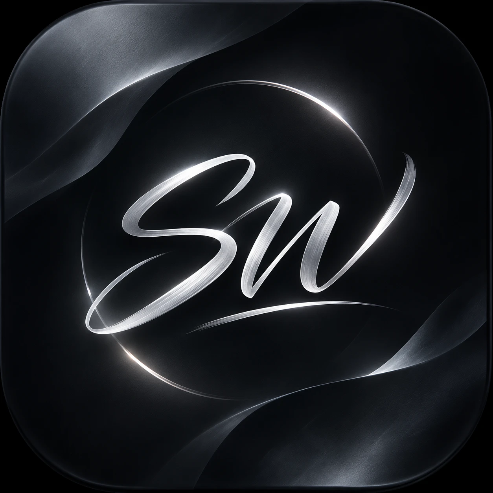
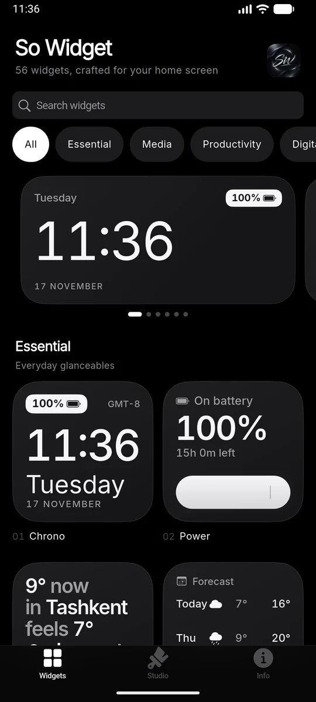
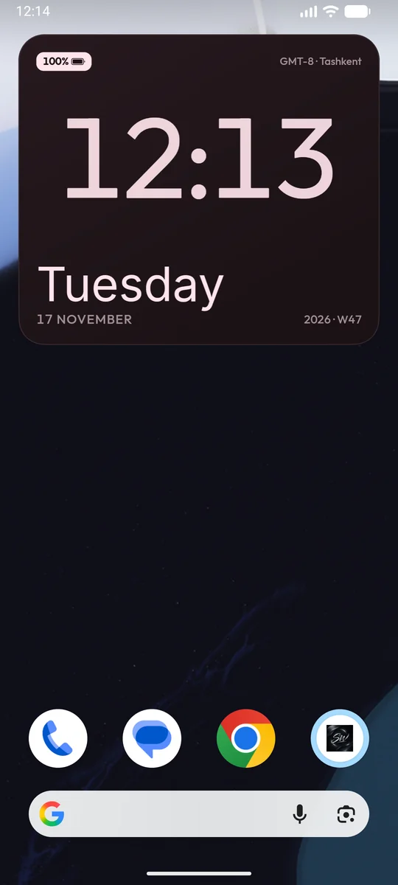
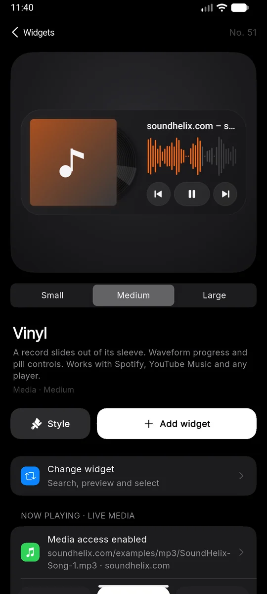
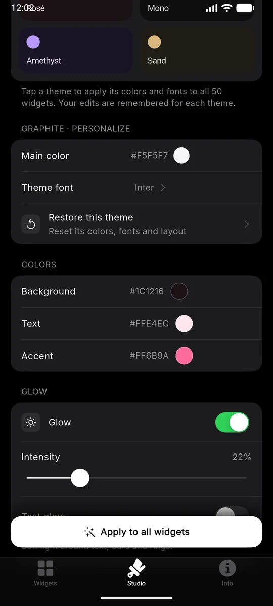
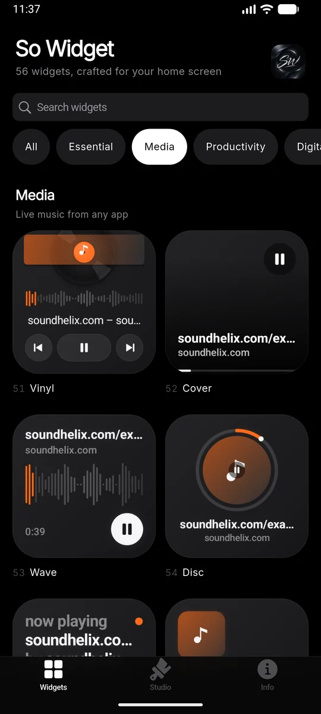
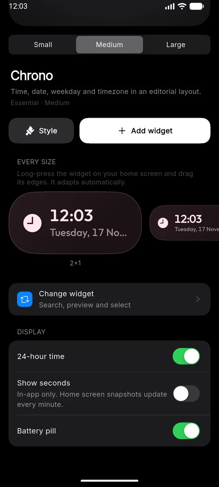
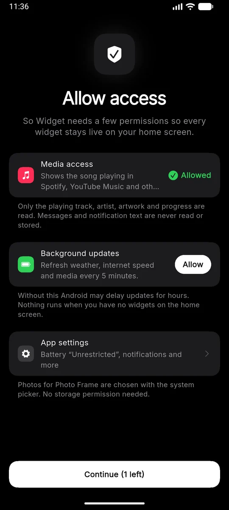

<div align="center">



# So Widget

**Premium home-screen widgets for Android. 60 widgets, one style, your wallpaper.**

[](https://github.com/qaxxorovxd-mobile/so-widget/releases/latest)


[**Download APK**](https://github.com/qaxxorovxd-mobile/so-widget/releases/latest) ·
[Website](https://qaxxorovxd-mobile.github.io/so-widget/) ·
[What's new](#whats-new-in-13)

<br>

&nbsp;
&nbsp;
&nbsp;


</div>

---

## Why So Widget

Most widget apps give you a pile of mismatched designs. So Widget gives every widget **one shared style** (font, colors, corners, outline and glass), so your home screen looks like it was designed in one piece. Change it in Studio, tap **Apply to all widgets**, and every widget on your home screen updates at once.

## Features

### 60 widgets in 7 collections

| Collection | Widgets |
| --- | --- |
| **Essential** | Chrono, Power, Atmosphere, Forecast, Calendar, Countdown, World Clock, Sun Cycle, Moon Phase, Air Quality |
| **Media** | Vinyl, Cover, Wave, Disc, Lyric Type, Capsule |
| **Devices** | Bluetooth, Controls, Batteries, Storage |
| **Productivity** | Focus, Tasks, Habit, Notes, Schedule, Progress, Time Tracker, Clipboard, Quick Links, Daily Brief |
| **Digital Life** | System Pulse, Network, GitHub Pulse, Server Status, Crypto Market, Currency, Stock Watch, Package Tracker, Website Monitor, Dev Feed |
| **Lifestyle** | Now Playing, Soundscape, Photo Frame, Daily Quote, Mood Journal, Hydration, Sleep Rhythm, Fitness Rings, Reading Tracker, Prayer Times |
| **Creative & Smart** | Minimal News, Space Live, Earth Events, Color Studio, Daily Wallpaper, Word of the Day, Language Cards, QR Studio, Mini Calculator, Quick Translate |

### Any size, pixel-perfect
Resize a widget on the home screen and it adapts: one-line glance at 1 row, compact at 2×2, wide at 4×2, full layout at 4×4. Images are drawn at the exact cell size, so every widget lines up.

### Live media
Now Playing and the six Media designs are drawn natively and follow Spotify, YouTube Music or any player instantly, with working ⏮ ⏯ ⏭ buttons.

### Studio
- 10 themes: Graphite, Midnight, Paper, Mist, Ember, Ocean, Rosé, Mono, Amethyst and Sand.
- Main color, iOS-like fonts (Inter, Geist, Nunito, Newsreader, Geist Mono…), font weight, text size, glow, corner radius, glass background and a shared outline.
- **Colors from your wallpaper**: change your wallpaper and Studio suggests four matching color sets (Tinted, Rich, Night, Light).
- **Your layout stays**: text size, outline, corners, weight and glass are kept when you switch themes or presets.

### Wallpapers by Wallhaven
4K phone wallpapers with real filters: vibes (Dark, AMOLED, Minimal, Neon, Space, Nature…), sorting, quality, shape, brightness, a 30-color palette and content type. You can **download to the gallery** with credits kept in the file, or **set as the home, lock or both screens** with your own crop.

<p>
&nbsp;
&nbsp;

</p>

## What's new in 1.3

- **Colors from your wallpaper**: Studio suggests widget colors that match your current wallpaper and updates when it changes.
- **Your layout stays**: personal layout settings survive theme and preset changes.
- **What's new** section in the Info tab.

See [all releases](https://github.com/qaxxorovxd-mobile/so-widget/releases).

## Install

1. Download `app-arm64-v8a-release.apk` (most phones) or `app-release.apk` (universal) from the [latest release](https://github.com/qaxxorovxd-mobile/so-widget/releases/latest).
2. Open it and allow installing from this source.
3. Long-press your home screen → **Widgets** → **So Widget**, or open a widget in the app and tap **Add widget**.

## Permissions

| Permission | Why |
| --- | --- |
| Notification access | Read the song that is playing for the media widgets. Nothing else is read or stored. |
| Battery unrestricted | Lets widgets refresh in the background about every 5 minutes. |
| Nearby devices (Bluetooth) | Show connected headphones and their battery in the Devices widgets. |
| Physical activity | Count steps for Fitness Rings. |
| Set wallpaper | Apply a wallpaper you picked. |
| Storage (Android 9 and older) | Save a wallpaper to the gallery. |

## Privacy

Your notes, tasks, habits and photos stay on your device. There are no accounts, no analytics and no ads. Network calls go only to the public data sources below. Your city is picked by hand, so the app never asks for your location.

## Data sources

| Data | Source |
| --- | --- |
| Weather & air quality | [Open-Meteo](https://open-meteo.com) |
| Crypto | [CoinGecko](https://www.coingecko.com) |
| Currency | Central Bank of Uzbekistan |
| Stocks | Yahoo Finance |
| Wallpapers | [Wallhaven](https://wallhaven.cc) ([API](https://wallhaven.cc/help/api) · [Terms](https://wallhaven.cc/terms)) |
| Photo widget samples | [Lorem Picsum](https://picsum.photos) |

### Wallpaper copyright

So Widget does not host any wallpapers. Every image is loaded from Wallhaven and belongs to its original artist. The app shows only SFW content, credits the uploader and the original source, and writes the credit into the saved file's EXIF. Wallpapers are for personal use. To report an image, use Wallhaven's [DMCA page](https://wallhaven.cc/dmca). So Widget is not affiliated with Wallhaven.

## Build from source

Requirements: Flutter 3.50+, the Android SDK and JDK 17.

```bash
flutter pub get
flutter run
```

```bash
flutter build apk --release --split-per-abi --no-tree-shake-icons
```

APKs are written to `build/app/outputs/flutter-apk/`.

```bash
flutter test test/responsive_test.dart test/wall_colors_test.dart
```

## Project structure

```
lib/
  core/      state, api, registry, home_sync, media, permissions, wallhaven, wall_colors
  ui/        widget kit, forms, style editor, theme studio, wallpaper match
  widgets/   essential, productivity, digital, lifestyle, creative, media
  screens/   gallery, wallpapers, wallpaper_view, studio, detail, info, permissions, picker, root
android/app/src/main/kotlin/uz/qaxxorov/so_widget/
  SoWidgets.kt      widget providers, per-instance images, sizes
  SoNowPlaying.kt   native media widgets
  SoMedia.kt        media session reader
  SoDevices.kt      Bluetooth, controls, batteries, storage
  SoWallpaper.kt    save to gallery, set wallpaper, wallpaper colors
  SoRefreshJob.kt   background refresh
```

iOS home-screen widgets need a WidgetKit extension built in Xcode, which is not included.

## Author

Designed and developed by **[qaxxorov.uz](https://qaxxorov.uz)**.

© 2026 qaxxorov.uz. All rights reserved.
